# Architecture Specification: Production-Grade RAG & Evaluation Harness

## 1. System Overview
Most demo Retrieval-Augmented Generation (RAG) applications suffer from high hallucination rates and low recall because they rely solely on naive vector similarity search. In production systems:
1. Lexical keywords, acronyms, and specific IDs (e.g., error codes, function names) fail in vector embeddings.
2. Vector embeddings capture semantic proximity but fail at exact precision.
3. Pure top-K similarity fails to re-rank the most contextually relevant passages to the top of the LLM context window.

This architecture solves these challenges through a three-stage retrieval pipeline: **Hybrid Search (Dense + Sparse) -> Reciprocal Rank Fusion (RRF) -> Cross-Encoder Reranking**, followed by an automated **Evaluation Harness** that quantitatively measures retrieval accuracy and answer faithfulness.

---

## 2. Ingestion & Retrieval Pipeline

```mermaid
flowchart TD
    subgraph Ingestion
        Doc["Raw Documents (.md, .txt, .pdf)"] --> Chunker["Sliding-Window Chunker (size: 500, overlap: 75)"]
        Chunker --> DenseEmbed["Dense Embedder (Vector Space)"]
        Chunker --> BM25Index["Sparse Lexical Index (BM25Okapi)"]
        DenseEmbed --> VectorStore[("Vector Store (Qdrant / In-Memory)")]
        BM25Index --> InvertedIndex[("BM25 Inverted Index")]
    end

    subgraph RuntimeQuery["Runtime Query & Retrieval"]
        Query["User Query"] --> QEmbed["Embed Query"]
        Query --> QTokens["Tokenize Query"]
        QEmbed --> DenseSearch["Dense Cosine Search (Top-15)"]
        QTokens --> SparseSearch["BM25 Keyword Search (Top-15)"]
        DenseSearch --> RRF["Reciprocal Rank Fusion (RRF k=60)"]
        SparseSearch --> RRF
        RRF --> Rerank["Cross-Encoder Reranker (Top-5)"]
        Rerank --> Gen["Grounded Generator with Citations"]
        Gen --> Output["Synthesized Answer + Document Footnotes"]
    end
```

---

## 3. Mathematical Foundations

### 3.1 BM25Okapi Formulation
For a query $Q$ consisting of terms $q_1, q_2, \dots, q_n$, the score for document $D$ is:
$$\text{Score}(D, Q) = \sum_{i=1}^{n} \text{IDF}(q_i) \cdot \frac{f(q_i, D) \cdot (k_1 + 1)}{f(q_i, D) + k_1 \cdot \left(1 - b + b \cdot \frac{|D|}{\text{avgdl}}\right)}$$
Where:
- $f(q_i, D)$ is term frequency.
- $|D|$ and $\text{avgdl}$ are document length and average document length.
- $k_1 = 1.5$ regulates term saturation.
- $b = 0.75$ controls document length normalization penalty.

### 3.2 Reciprocal Rank Fusion (RRF)
To combine dense vector search and sparse keyword search without needing to normalize disparate unbounded score ranges, RRF computes:
$$\text{RRF\_Score}(d) = \sum_{m \in M} \frac{1}{k + r_m(d)}$$
Where $r_m(d)$ is the 1-based rank of document $d$ within retriever $m \in \{\text{Dense}, \text{BM25}\}$, and $k=60$ is the standard smoothing constant.

---

## 4. Evaluation Harness Metrics

The evaluation harness objectively scores retrieval systems against gold-standard query-passage mappings:
1. **Hit Rate @ K**: Binary indicator whether at least one ground-truth chunk exists within the top-$K$ retrieved candidates.
2. **Mean Reciprocal Rank (MRR)**: Average reciprocal rank ($1/\text{rank}$) of the first relevant chunk retrieved.
3. **Context Precision**: The proportion of retrieved top-$K$ chunks that are genuinely relevant.
4. **Faithfulness**: Lexical and semantic overlap between claims made in the synthesized answer and the verified retrieved context.
